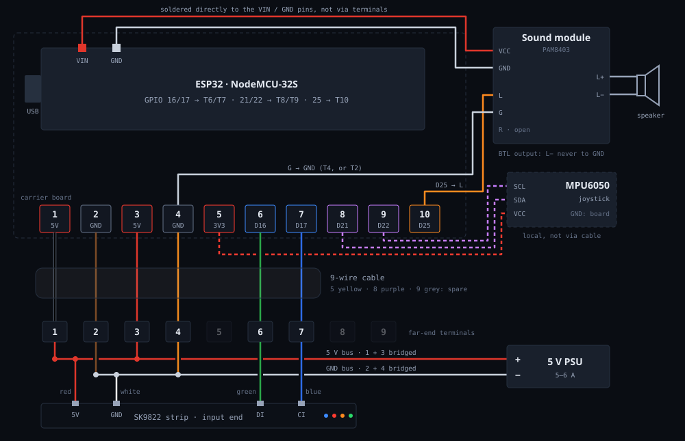

# Field Guide

Every level in the game, mapped to the coordinates it uses, what the four
planned upstream features would cost to build, and the current wiring. Read off
the source (`loadLevel()` in `src/TWANG32.ino`), not off the README.

**Visual version:** [`field-guide.html`](field-guide.html) has to-scale level
maps, the terminal strip and the schematic. Open it in a browser. The same page
is in the TWANG portal under **Handbuch** (<https://app.thingware.ch/twang/#handbuch>).
Keep the two copies identical: `docs/field-guide.html` here and
`thingware-twang/code/public/static/handbuch.html`.

21 levels · 1000-unit playfield · scoring and the boss are described below.

## Part one: the 21 levels

The game runs on a virtual 1000-unit line that gets scaled to whatever strip is
fitted, so every position below is exact and strip-independent. You start at the
left and the exit is always the far right.

| # | Level | Layout | What it teaches |
|---|---|---|---|
| 0 | **Intro** (`INTRO`) | player starts at 150 | An empty lane. Nothing can kill you — the level exists purely to teach that tilting moves you and that the far end is the goal. |
| 1 | **First enemy** (`ENEMY_INTRO`) | enemy @900, speed 1, moving down | One slow enemy walking toward you. This is where you learn the **twang**: shake the spring and everything inside the attack width dies. |
| 2 | **First spawner** (`SPAWNER_INTRO`) | spawner @950, one every 4000 ms, speed 2 | An endless source at the far end. Not a puzzle so much as a metronome — you learn that pressure is continuous, not a fixed number of kills. |
| 3 | **First lava** (`LAVA_INTRO`) | lava 400–490, 2000 on / 2000 off  ·  spawner @950 every 4500 ms | Lava blinks on and off on a two-second cycle while a spawner keeps feeding enemies at you. The lesson is that **waiting has a cost**. |
| 4 | **Lava on the move** (`LAVA_MOVING`) | lava 700–800, flow −0.5  ·  spawner @950 every 4500 ms | The same pool, but drifting toward you at 0.5 units a tick. Standing still is now actively losing ground. |
| 5 | **Spreading lava** (`LAVA_SPREADING`) | two pools, growth 0.2 each  ·  two enemies at speed 2 | Two pools, both growing outward. The safe gaps shrink while you work, so the level punishes hesitation twice over. |
| 6 | **Wobblers** (`ENEMY_SIN_INTRO`) | enemy @700 sweeping ±275  ·  enemy @500 sweeping ±250 | Enemies that sweep back and forth in a sine pattern instead of marching. Your attack has to be timed to where they *will* be. |
| 7 | **Wobbler swarm** (`ENEMY_SIN_SWARM`) | six wobblers, sweep radii 150 to 350 | Six sweeping enemies with deliberately overlapping ranges. There is no safe standing spot — only a moving gap you have to read. |
| 8 | **Lava from behind** (`LAVA_MOVING_UP`) | lava 0–100, growth 1.0  ·  spawner @950 every 2500 ms  ·  player starts at 200 | The first level that takes your retreat away: lava grows out of the start position at the maximum rate while a fast spawner pushes back. Forward is the only direction left. |
| 9 | **First conveyors** (`CONVEYOR_INTRO`) | belt 100–450 at −3  ·  belt 550–900 at −6 | Two belts, both dragging you backward, the second twice as hard as the first. Movement stops being free. |
| 10 | **Conveyor into the wall** (`CONVEYOR_ENEMIES`) | belt 50–1000 at +6  ·  seven static enemies, 300 to 900 | The belt runs the whole strip and pushes you **forward**, into seven stationary enemies. A clearing exercise under a conveyor you cannot fight. |
| 11 | **Spread and fall** (`LAVA_SPREAD_FALL`) | two pools, growth 0.25, flow −0.5  ·  spawner @950, no start delay | Pools that grow and flow toward you at the same time — the two lava mechanics combined, with the spawner starting immediately rather than after a delay. |
| 12 | **Lava run** (`LAVA_RUN`) | pools at 200–300, 400–600 (starts ON), 700–800 (1250/750)  ·  spawner speed 4 | Three pools on different cycles, the middle one lit from the start, the last one on a faster rhythm than the rest. A timing gauntlet with speed-4 enemies arriving throughout. |
| 13 | **Halt test** (`CONVEYOR_HALT_TEST`) | belt 100–400 at −4  ·  belt 500–800 at −6  ·  enemies at 450 and 850 | Two backward belts with a single enemy parked in the gap between them. You have to stop precisely in the dead zone to make the kill — the most technical level in the set. |
| 14 | **The train** (`SPAWNER_TRAIN`) | spawner @900 every 1300 ms, speed 2 | A spawner firing every 1.3 seconds — three times the rate of anything before it. Pure throughput: can you kill as fast as it produces? |
| 15 | **Skinny train** (`SPAWNER_TRAIN_SKINNY`) | attack_width = 32 (default 70)  ·  spawner @900 every 1800 ms | The same idea with the pressure eased slightly — and your **attack width cut from 70 to 32**. The one level that changes your capabilities rather than the obstacles. |
| 16 | **Split** (`SPAWNER_SPLIT`) | two spawners @550, opposite directions, every 1500 ms | Two spawners stacked at the same point, one firing each way. Enemies come at you from ahead and from behind the midpoint simultaneously. |
| 17 | **Split with lava** (`SPAWNER_SPLIT_LAVA`) | two spawners @500 every 1200 ms  ·  lava 900–950, 2200 on / 800 off, delayed 2000 ms | The split, tightened to 1.2 seconds, plus lava guarding the exit on an uneven cycle. You have to survive the crossfire *and* time the last step. |
| 18 | **Conveyor and lava** (`CONVEYOR_LAVA`) | belts at −4, −6, +6  ·  three pools, the last 3000 on / 1000 off | Belts and pools alternating along the entire strip, the last belt reversing to shove you into the final pool. An obstacle course with no enemies at all. |
| 19 | **Everything at once** (`CONVEYOR_ENEMY_SIN`) | belt 100–900 at −4  ·  spawner @950 (+3 s)  ·  spawner @0 (+10 s)  ·  three wobblers | Three wobblers, a full-length backward belt, and spawners at *both* ends staggered so the second one opens up ten seconds in, once you think you have read the level. |
| 20 | **Boss** (`BOSS`) | boss lives 3 · positions 800 → 200 → 600 · spawn rate 1800 → 1500 → 1000 ms | Three lives. Each hit teleports it, **800, then 200, then 600**, and speeds up its output, from one enemy every 1.8 s to one every second, fired in both directions at once. The only enemy that fights back by moving. |

### Beating the boss

The dark red bar is the boss. Touching it costs a life. Stand a few LEDs in front
of it and twang: a hit counts when the attack width reaches the bar. After the
first hit it reappears at 200, **behind** the player. Kill the incoming enemies
first and advance in the gaps. After the third hit a blue pixel lights at the far
end. That is the exit.

### Scoring

Per cleared level (the intro gives nothing): 100 + 10 per remaining life + a time
bonus of `(20 s − time) / 100 ms` if faster than 20 s. The boss kill adds 500.

| Situation | Minimum |
|---|---|
| Boss reached (19 scored levels, 1 life left each, no time bonus) | 19 × 110 = **2090** |
| Boss killed (+ boss level 110 + boss bonus 500) | **2700** |

Without a time bonus the ceiling up to the boss is 19 × 130 = 2470. Anything above
that is speed.

## Part two: the four planned features

Upstream's TODO list, costed against the code as it stands. **S** is an evening,
**M** a day or two, **L** a project in its own right.

### Settings: change strip type (M, half done)

The RGB/RGBW half is shipped: the runtime `W=0|1|2` switch. Still open is
switching between WS2812 and APA102 without recompiling. `FastLED.addLeds<CHIPSET, PIN>()`
is resolved at compile time, but you do not have to choose: register both
controllers at boot and use `CLEDController::setEnabled()` to mute the unused one.
Cost: a few hundred bytes of RAM. Snag: APA102 needs a clock pin, so keep GPIO 17
reserved.

### Digitised audio, with mixing (M)

Today a hardware timer toggles the internal DAC to make a square wave. The audio
surface is five functions and five call sites, so the engine can be swapped
without touching game logic.

- An I2S output stage feeding a mixer with about four voices (sample pointer,
  position, gain).
- `sound(freq, vol)` stays as the compatibility path; effects move to
  `play(SFX_KILL)` one at a time.
- Lava hum and movement can finally overlap.

Snag: flash, not code. About 470 KB free is roughly 21 s at 22 kHz 8-bit mono:
enough for effects, not for music. `SoundData.h` already holds 14 KB of unused WAV
data.

### A web interface that behaves like an app (M)

The current server reads the socket byte by byte and parses `GET /?` by hand.

- Replace the parser with `WebServer` or `ESPAsyncWebServer`.
- One small page plus `/api/settings` in JSON (GET reads, POST writes).
- Keep `/metrics` (Prometheus) as it is.
- Add mDNS: `twang.local` instead of `192.168.4.1`.

Snag: serve the page from PROGMEM, not SPIFFS, so UI and firmware never drift
apart.

### Two players over a wireless link (L)

The difficulty is design, not code.

- Transport: ESP-NOW, not WiFi (sub-10 ms, no AP). ESP-NOW and a running SoftAP
  share one radio and channel, so the settings AP must yield during a match.
- Topology: one device owns the game state, the other sends its joystick and
  receives what to draw. Never let both simulate.
- Game: two players entering the same strip from opposite ends.

The code already supports a second MPU6050 at 0x69. One at each end of a single
strip gives local two-player with no radio, a cheap way to find out whether the
mode is fun.

## Part three: what I would add

Ordered by leverage.

- **OTA updates (S).** Ends opening the enclosure to reach USB. *(Done since: ArduinoOTA plus cloud OTA.)*
- **Stop writing EEPROM on every death (S).** Stats are committed at every game
  over; one unattended session reached 58 erase cycles. Write on a timer or when
  idle.
- **Levels as data, not a switch statement (M).** Every level is a short list of
  spawn calls. As an array of records, levels become editable over the web UI,
  shareable as JSON, and reusable by any future mode. Do this before two-player.
- **Lamp mode.** Expose the screensavers (Fire2012, sinelon, juggle) as an ambient
  mode.
- **High scores with initials.** Five entries, tilt to pick a letter, twang to
  confirm.
- **Practice / level select.** `V=` already jumps to a level; surface it in the
  web UI.
- **Haptics on hit.** A small vibration motor in the knob on a spare GPIO.
- **Attack cooldown and combos.** Give the twang a cost and the score some texture.
- **Adaptive difficulty.** Scale spawner rates and enemy speeds by recent
  performance.

## Part four: a sensible order

| Step | Work | Size | Why here |
|---|---|---|---|
| 1 | OTA updates | S | Every later step gets faster to test, and the enclosure can stay shut |
| 2 | EEPROM write batching | S | A real defect, and cheap to fix now |
| 3 | I2S audio engine | M | The PCM5102 is on its way; the API surface is five functions |
| 4 | Web UI rewrite + mDNS | M | Replaces the brittle parser and gives the level editor a home |
| 5 | Levels as data | M | Needs step 4; unlocks the editor and simplifies step 7 |
| 6 | Local two-player, two MPUs | M | Answers "is this fun?" before any radio work |
| 7 | Wireless two-player | L | Only worth building once step 6 says yes |

## Part five: wiring

The full wiring reference is [`WIRING.md`](WIRING.md).

---

TWANG32 by bdring, from TWANG by Critters, after Line Wobbler by Robin Baumgarten.
Effort sizing is a judgement call, not a measurement.
