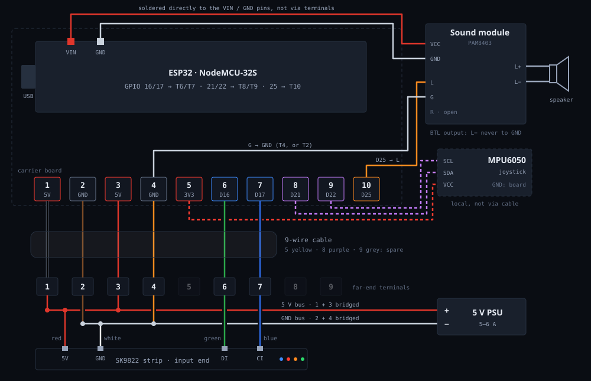

# Wiring — controller board, 9-wire cable, LED strip, sound module

Power and the LED strip no longer use separate cables (USB for power on the
ESP32's micro-USB port, plus a second cable for the strip). Both now run
over **one 9-conductor serial cable**. The cable carries only strip power
and the two strip signals; everything else stays on the controller board.

```
                      ┌──────────── sound module (PAM8403) ── speaker
                      │  VCC/GND: soldered to ESP32 VIN/GND pins
                      │  L: terminal 10, G: GND terminal
 [ESP32 board] ───────┤
 terminals 1-10       │  MPU6050: terminals 5 / 8 / 9 (local)
                      │
                      └── 9-wire cable (1,2,3,4,6,7 used) ── far end
                                                             ├─ LED strip
                                                             └─ 5 V supply
```

## Schematic



The interactive version with the terminal strip is in
[`field-guide.html`](field-guide.html) (part five) and in the TWANG portal under
**Handbuch**.

## Controller board terminals

The ESP32 module is soldered onto a carrier board. Next to it is a row of
**10 terminals, numbered 1-10. Terminal 1 is at the end nearest the ESP32
module's USB socket.**

| Terminal | Signal | Goes to |
|---|---|---|
| 1 | 5V / VIN | cable conductor 1 (black) |
| 2 | GND | cable conductor 2 (brown) |
| 3 | 5V / VIN | cable conductor 3 (red) |
| 4 | GND | cable conductor 4 (orange), sound module **G** |
| 5 | 3.3 V | MPU6050 VCC (local, not in the cable) |
| 6 | GPIO 16 | cable conductor 6 (green), LED data (`DATA_PIN`) |
| 7 | GPIO 17 | cable conductor 7 (blue), LED clock (`CLOCK_PIN`) |
| 8 | GPIO 21 | MPU6050 SDA (local, not in the cable) |
| 9 | GPIO 22 | MPU6050 SCL (local, not in the cable) |
| 10 | GPIO 25 | sound module **L** (DAC audio) |

The ESP32 is powered through VIN (terminals 1/3, from the supply at the far
end), not through micro-USB. The USB socket is now only for flashing and the
serial console.

> Do **not** have the external 5 V supply and a USB cable on at the same time
> unless the module has a diode between USB 5 V and VIN. Otherwise the two
> sources feed into each other. Most ESP32 dev boards have that diode; check
> the module before relying on it.

## 9-wire cable

Terminal *n* on the board connects to conductor *n* connects to terminal *n*
at the far end (1:1).

| Terminal | Wire color | Signal |
|---|---|---|
| 1 | black | 5V / VIN |
| 2 | brown | GND |
| 3 | red | 5V / VIN |
| 4 | orange | GND |
| 5 | yellow | **spare**, not connected |
| 6 | green | GPIO 16, LED data |
| 7 | blue | GPIO 17, LED clock |
| 8 | purple | **spare**, not connected |
| 9 | grey | **spare**, not connected |
| GND | shield / drain: bare copper wire in a clear sleeve, marked "Male", **no terminal at the end** | |

**Watch out for the colors.** In this cable **black is +5 V** (terminal 1) and
**red is +5 V too** (terminal 3), while brown and orange are GND. That does not
follow the usual "red = +, black = −" convention. Go by terminal number, never
by color.

## LED strip (far end)

The strip is SK9822 / APA102 (clocked); firmware: `USE_SK9822` in
`src/config.h`.

| Strip wire | Terminal | Cable wire | Signal |
|---|---|---|---|
| red | 1 | black | 5 V |
| white | 2 | brown | GND |
| green | 6 | green | data (GPIO 16) |
| blue | 7 | blue | clock (GPIO 17) |

At the far end, bridge **3 onto 1** and **4 onto 2** so both conductor pairs
carry the strip current, and connect the 5 V supply to the same two points.

> **Corrected 2026-11-07.** The first version had red and white swapped
> (white on 1, red on 2), which put the strip's red +5 V wire on GND. If a
> strip is ever re-wired, check the labels printed on the strip PCB at the
> input end (`5V` / `GND` / `DI` / `CI`) rather than trusting wire colors.

## Sound module (controller side)

PAM8403 amplifier board (GF1002). It sits on the controller side, because
GPIO 25 has no conductor in the cable.

| Module pin | Connects to | Note |
|---|---|---|
| VCC / + | ESP32 **VIN** pin, soldered wire | **not** through a terminal |
| GND / − | ESP32 **GND** pin, soldered wire | **not** through a terminal |
| **L** (input) | **terminal 10** (GPIO 25, DAC) | |
| **G** (input) | **GND terminal** (2 or 4) | |
| R (input) | open | the DAC is mono. Bridge it onto L to play the same signal on both channels. |
| L+ / L− (output) | speaker (4 Ω) | |

> **BTL output.** The PAM8403 drives both output pins. The speaker goes
> *only* between L+ and L−. Never connect L− (or R−) to GND, and never share
> a ground wire with the speaker. That kills the amplifier.

The amplifier's gain is fixed at ~24 dB, so the module's volume pot sits near
its minimum. Set it low once and adjust volume in software with `S=`.

## Notes

- **Current.** The strip budget is `M=4200` (4.2 A), carried by two
  conductors each for 5 V and GND (see the bridges above). A serial cable's
  conductors are still thin. For long runs or high brightness, feed the
  strip's power at the far end directly from the supply, and keep the common
  GND through the cable.
- **Shield.** Connect it to GND **at one end only**, the board end. Grounded
  at both ends it forms a ground loop parallel to the GND conductors.
- **Spare conductors** 5, 8 and 9 are free for later, e.g. a second sensor or a
  button at the far end.
